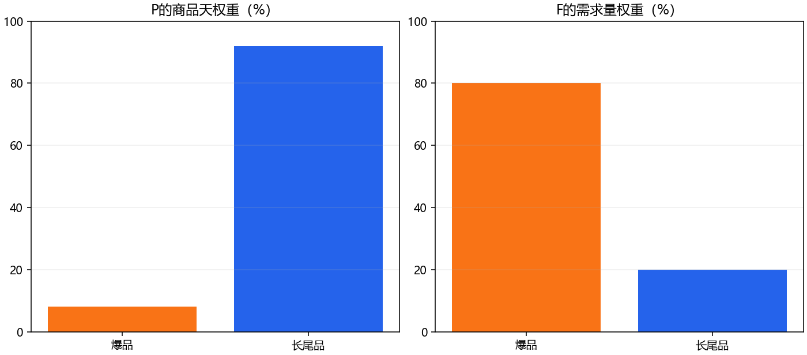
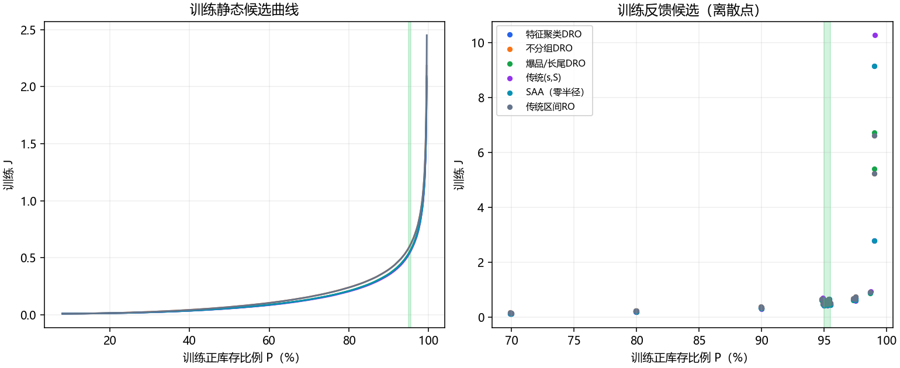
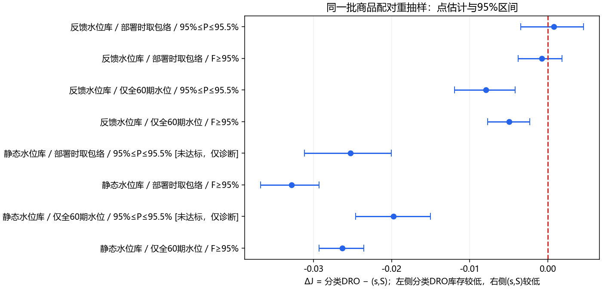

## 完整实验报告：服务约束、反馈控制与风险包络

2026年10月16日。问题：旧版需求满足率约束下分类DRO最小，新版正库存比例约束下(s,S)最小，这一差异究竟由什么造成？

历史新旧版的最优方法不同，来自服务指标与策略实现共同作用。受控实验支持“可行域改变会改变最优参数与部分方法排序”，但没有支持“只要把需求满足率改成正库存比例，就必然由分类DRO变成(s,S)最优”。

历史结果已逐条回放核验：旧版分类DRO相对(s,S)的ΔJ=-0.003757；当前新版为+0.000949。新版数值上(s,S)更低，但其95%商品块重抽样区间为[-0.003309, +0.004777]，跨过0，不能据此声称稳定优于分类DRO。

当前正式交付结果保持不变。本轮是解释原因的诊断实验，扩大了反馈候选范围，实验中的最优数值不覆盖之前已经交付的Excel、动画或冻结参数。

|证据层次|本轮获得的结论|
|---|---|
|数学机制|F按需求量加权，P按商品天等权；两者可行域不同，最优策略可能不同。|
|仅切换约束|静态、无包络：F约束测试最优为分类DRO；P下限测试最优为SAA。分类DRO与(s,S)这一对没有反转。|
|开关部署包络|固定反馈候选与P约束：不开包络分类DRO更低；开包络(s,S)数值更低。两者均达标。|
|只增加95.5%上限|本轮全部方法、库的最优候选均未改变，上限在训练最优点没有约束作用。|
|预测差异核查|焦点两方法的新旧四期预测逐值一致；六方法最大差异仅3.64e-12，属于浮点舍入。|

## 1. 数据、版本与历史结果复核

原始训练文件replenishment_train.xlsx包含60期×6000商品，原始测试文件replenishment_test.xlsx包含28期×6000商品。原始20个特征、初始库存与爆品/长尾标签均通过已校验缓存读取，输入和缓存SHA256见outputs/input_audit.json。训练需求为360000个观测。测试Period_1重新开始，初始在途0，全部168000商品天参与计分。

历史需求版来自experiments/demand_fill_v3/with_ro/outputs_v4；正式当前版来自experiments/service95_revision/outputs_v4。逐条重建销量=min(可用库存,需求)、期末库存、L=1到货关系，并分别回放旧版冻结静态水位及新版冻结反馈策略；四期计划也逐值匹配。所有文件哈希保存于published_audit.json。这里只回放冻结策略，没有声称重新训练历史模型或重选历史参数。

|版本|方法|F|P|J|
|---|---|---|---|---|
|old|特征聚类DRO|96.5467%|76.4310%|0.169025|
|old|不分组DRO|96.7806%|74.7048%|0.177925|
|old|爆品/长尾DRO|96.5615%|76.7173%|0.168340|
|old|传统(s,S)|96.5722%|76.1512%|0.172097|
|old|SAA（零半径）|96.9426%|80.9131%|0.186779|
|old|传统区间RO|96.7100%|74.2548%|0.174962|
|current|特征聚类DRO|98.6518%|95.2798%|0.355650|
|current|不分组DRO|98.9762%|95.2893%|0.457866|
|current|爆品/长尾DRO|98.6464%|95.2821%|0.346907|
|current|传统(s,S)|98.5537%|95.2810%|0.345958|
|current|SAA（零半径）|98.6498%|95.2798%|0.355335|
|current|传统区间RO|98.9763%|95.2887%|0.457914|

焦点方法的新旧预测逐值相同；12组历史轨迹中仅旧版RO预测存在最多3.63797880709e-12的保存舍入差。由此排除有实质量级的预测差异。历史两版仍改变了风险函数（stop-loss与机会水位）、风险参数、整数正库存保护、验证规则、包络与反馈，不能把整套变化叫作“只改约束”。

## 2. 实验问题、因素及对照关系

研究问题分三层：固定候选策略后切换约束，是否改变训练最优参数或测试方法排序？反馈库与部署风险包络是否改变焦点两方法的相对J？历史数值胜负在配对商品构成扰动下有多稳定？方案在本轮计算前写入protocol.json；由于测试文件已经多次看过，这不是盲测或全新预注册研究。

|因素|水平|固定与变化|
|---|---|---|
|外层服务约束|F≥.95 / P≥.95 / .95≤P≤.955|同一候选得分只计算一次，三组仅改变可行性筛选|
|控制器候选库|静态 / 反馈 / 二者并集|每库内部三组约束使用完全同一候选集|
|最终部署风险|full60 / envelope|选择相同训练候选后，仅替换最终部署风险水位|
|共同设置|L=1、H=4、失销、原始库存|最终模型60期，测试28期，含首期；目标及平局规则一致|

共3约束×3候选库×2部署×6方法=108个选中实验单元。并集组复用静态和反馈候选，三约束也复用同一得分；不把重复结果伪装成独立样本。最终只有24个唯一选中候选×2部署=48次唯一测试回放。

## 3. 数学模型与可行域证明

J = sum(I) / sum(d)，越低越好；F = sum(sales) / sum(d)；P = count(I > 0) / (N*T)。J是累计期末库存与累计需求之比，并非通常的销量/平均库存周转次数。恰好售罄的商品天在P中记0，尽管当天需求可能已全部满足。

测试中爆品仅480种、占商品天8%，却占需求量79.9954%；长尾5520种、占商品天92%，只占需求量20.0046%。因此，F对爆品销量更敏感，P对大量长尾商品是否留有正库存更敏感。

固定策略集合Pi及同一批数据：pi_F = argmin{J(pi): F(pi)>=0.95}；pi_P = argmin{J(pi): P(pi)>=0.95}；pi_band = argmin{J(pi): 0.95<=P(pi)<=0.955}。目标不变，允许参与比较的策略改变。新最优点既可能变化，也可能保持不变。

一个可核算的逻辑例子：20个商品的需求为(1000,1,...,1)。策略A可用库存(1000,0,...,0)，策略B为(1001,2,...,2,0)。A的F=1000/1019、P=0、J=0；B的F=1018/1019、P=19/20、J=19/1019。在仅含A、B的策略库中，F≥95%选A，而95%≤P≤95.5%选B。这个例子证明“可以改变”，不替代真实数据的实验。

库存流转：A(i,t)=I(i,t-1)+q(i,t-1)，sales(i,t)=min(A(i,t),d(i,t))，I(i,t)=A(i,t)-sales(i,t)，lost(i,t)=d(i,t)-sales(i,t)。本期观察需求后决定q(i,t)，下期需求前到货；缺货丢失，不回补历史欠货。所有订单为非负整数。

静态水位：S(i,t,h)=floor(k*m(i,t,h)*z(i))+1；q(i,t,h)=max(0,ceil(S(i,t,h)-projected_I))。未来库存按预测需求路径递推，只有h=1订单执行。(s,S)还要求projected_I<floor(k*m*s)+1才下单。未来计划绝不使用未来实际需求。

DRO基础：相对需求r=d/max(m,1)，按对应商品池建立等权经验分布及W-infinity半径epsilon，机会水位z=kappa*(r_(ceil(beta*M))+epsilon)。SAA的epsilon=0；传统RO为非负需求箱集合的上端mu+Gamma*sigma，不对集合赋予概率；(s,S)是逐商品分位数与池分位数的加权和，权重为残差期数/(残差期数+24)。

机会水位的依据：W-infinity半径epsilon允许每个等权经验样本在距离epsilon内移动。令k=ceil(beta*M)，目标整数库存严格大于预测值乘以第k个上端点，则至少k个原子所对应的整个移动区间均位于库存之下，因而最坏分布的正库存概率至少为k/M≥beta。目标取floor(m*z)+1处理整数和相等边界。该结论描述固定基础水位，并不扩展成动态lambda后的有限测试保证。

旧版DRO使用另一种风险函数：找最小z使sup_Q E[(R-z)_+-(1-beta)R]≤0。在W-infinity球中，对每个样本的非负区间端点求凸分段线性函数的最大值，再取均值；通过单调二分求根。它控制最坏期望失销量相对于最坏约束表达中的需求量，不是要求beta比例商品天留有库存。旧版与新版连内部鲁棒函数也改变了，这是历史整套对照中的混杂因素；本轮共同候选库统一采用当前机会水位，专门隔离外层可行性规则。

最终包络z_env(i)=max_b z_b(i)，b取全60期、训练1–24、1–36、1–48、29–60。所有切片都属于训练文件。验证阶段两种部署干预均只使用29–60拟合出的同一基础水位，不把1–28验证需求用于风险水位估计；包络是选参后发生的部署干预。它与正式版风险包络一致，且消除了验证数据回流的混杂。

反馈：C_t为已实现正库存商品天，内部目标p*来自声明候选；u_t=clip((28*N*p*-C_t)/(N*max(27-t,1))+bias,0,1)，这里t为0起算。以训练残差CDF和最近w期已发生单步相对误差CDF估计下一期服务率，取满足估计服务不低于u_t的最小公共lambda。CDF各用128个中点分位数近似，先验权重a/(a+n)，16次二分，lambda上限128。首期需求不伪装成事前单步误差。

lambda可以小于1，因此固定DRO水位的beta保护不自动成为执行策略保证。实验比较的是鲁棒基础水位加公共反馈的可实施策略。没有求解原始所有非预见策略中的全局多期最优解；H=4采用预测路径滚动计划。实际P达标由完整测试计数确认。

## 4. 特征聚类、预测与训练流程

特征聚类包含5个需求描述：log(1+均值)、log(1+变异系数)、零需求比例、log(1+95%分位数/均值)、log(1+后8期均值/前8期均值)。原始20特征按拟合段时间均值标准化并做PCA，取前3成分，标准化后权重0.5；与5个标准化需求特征拼接。K-means固定6类、随机种子20260929、8次初始化、60次迭代，以平方误差最小者为准。

特征聚类DRO按6池，不分组DRO和RO用统一池，分类DRO按480爆品/5520长尾，SAA及(s,S)的池与特征聚类一致。预测参数固定为历史训练验证得到的blend=1、window=3、prior=0。拟合独立线性时间趋势，滚动用已观测的最近3期校正，预测不得低于1。测试未来特征不输入。

本轮反馈与静态参数统一使用训练29–60拟合、训练1–28回溯留出选择，块不重叠。最终重新用训练全部1–60拟合预测器、聚类和扩展窗残差；残差前18期暖启动，19–60期产生样本外残差。训练最早28期参与选参检验及最终60期拟合，并未丢弃。回溯留出不是向未来预测成绩。

## 5. 完整候选库与冻结程序

每方法231个静态倍率k=0.20,0.21,...,2.50；39个反馈候选：p*=.9525时w∈{1,3,7}、a∈{0,3}、bias∈{-.01,0,.01}共18个，加上固定w=3、a=3时p*∈{.70,.80,.90,.95,.955,.975,.99}与3个bias共21个。每方法270个，合计1620个。所有目标p*均同时提供给三种约束，绝不按约束偷偷更换库。

基础固定参数沿用当前正式版：三种DRO beta=.975、epsilon=.005、kappa=1；SAA epsilon=0；(s,S)分位数.975/.985；RO Gamma=3。各方法不是被给予相同水位数值，而是同一候选规模和筛选规则。基础参数从既有训练流程沿用，本实验不穷尽其所有可能取值。

先冻结protocol.json，再计算训练得分；对每方法与候选库，用对应约束筛选，最小化J，平局按候选号。将54条选择和全部模型/水位散列写入frozen_selection.json，之后才回放测试。读取原始文件作哈希审计会接触测试文件字节，但本轮选参没有使用任何测试数值成绩。

|方法|候选库|总候选|F可行|P下限可行|P区间可行|F与P区间交集|
|---|---|---|---|---|---|---|
|特征聚类DRO|静态水位库|231|163|127|2|2|
|特征聚类DRO|反馈水位库|39|36|26|19|19|
|特征聚类DRO|二者并集|270|199|153|21|21|
|不分组DRO|静态水位库|231|166|127|3|3|
|不分组DRO|反馈水位库|39|39|28|21|21|
|不分组DRO|二者并集|270|205|155|24|24|
|爆品/长尾DRO|静态水位库|231|164|127|3|3|
|爆品/长尾DRO|反馈水位库|39|36|27|20|20|
|爆品/长尾DRO|二者并集|270|200|154|23|23|
|传统(s,S)|静态水位库|231|162|126|2|2|
|传统(s,S)|反馈水位库|39|36|28|21|21|
|传统(s,S)|二者并集|270|198|154|23|23|
|SAA（零半径）|静态水位库|231|163|127|3|3|
|SAA（零半径）|反馈水位库|39|36|26|19|19|
|SAA（零半径）|二者并集|270|199|153|22|22|
|传统区间RO|静态水位库|231|173|137|3|3|
|传统区间RO|反馈水位库|39|39|28|21|21|
|传统区间RO|二者并集|270|212|165|24|24|

## 6. 训练选择与测试优胜必须分开

|约束|库/部署|训练优胜|该方法测试达标|测试达标数|测试描述性优胜|
|---|---|---|---|---|---|
|F≥95%|静态水位库/仅全60期水位|爆品/长尾DRO|是|6|爆品/长尾DRO|
|F≥95%|静态水位库/部署时取包络|爆品/长尾DRO|是|6|爆品/长尾DRO|
|F≥95%|反馈水位库/仅全60期水位|不分组DRO|是|6|不分组DRO|
|F≥95%|反馈水位库/部署时取包络|不分组DRO|是|6|爆品/长尾DRO|
|F≥95%|二者并集/仅全60期水位|爆品/长尾DRO|是|6|爆品/长尾DRO|
|F≥95%|二者并集/部署时取包络|爆品/长尾DRO|是|6|爆品/长尾DRO|
|P≥95%|静态水位库/仅全60期水位|SAA（零半径）|是|6|SAA（零半径）|
|P≥95%|静态水位库/部署时取包络|SAA（零半径）|是|6|爆品/长尾DRO|
|P≥95%|反馈水位库/仅全60期水位|传统(s,S)|是|6|爆品/长尾DRO|
|P≥95%|反馈水位库/部署时取包络|传统(s,S)|是|6|传统(s,S)|
|P≥95%|二者并集/仅全60期水位|传统(s,S)|是|6|爆品/长尾DRO|
|P≥95%|二者并集/部署时取包络|传统(s,S)|是|6|传统(s,S)|
|95%≤P≤95.5%|静态水位库/仅全60期水位|SAA（零半径）|否|0|无|
|95%≤P≤95.5%|静态水位库/部署时取包络|SAA（零半径）|否|0|无|
|95%≤P≤95.5%|反馈水位库/仅全60期水位|传统(s,S)|是|6|爆品/长尾DRO|
|95%≤P≤95.5%|反馈水位库/部署时取包络|传统(s,S)|是|6|传统(s,S)|
|95%≤P≤95.5%|二者并集/仅全60期水位|传统(s,S)|是|6|爆品/长尾DRO|
|95%≤P≤95.5%|二者并集/部署时取包络|传统(s,S)|是|6|传统(s,S)|

训练优胜用于选择规则的解释；测试描述性优胜仅对已冻结的6方法回放结果进行比较。静态P区间组测试无达标方法，不能用其J排序宣称可行最优。并集F组训练选择静态候选，P组选择反馈候选，这反映改变可行域会改变控制器类型。

## 7. 108实验单元完整结果

## F≥95% | 静态水位库 | 仅全60期水位

|方法/候选号|训练F|训练P|训练J|测试F|测试P|测试J|测试达标|
|---|---|---|---|---|---|---|---|
|特征聚类DRO / 68|95.1658%|70.9280%|0.140315|96.8806%|80.8369%|0.184260|是|
|不分组DRO / 335|95.2268%|66.6262%|0.138324|97.1732%|77.3012%|0.196570|是|
|爆品/长尾DRO / 607|95.0406%|69.6512%|0.133623|96.6177%|79.9036%|0.171392|是|
|传统(s,S) / 879|95.2383%|71.3095%|0.139971|97.0498%|82.2780%|0.197701|是|
|SAA（零半径） / 1148|95.0489%|70.4321%|0.137304|96.7994%|80.4393%|0.180747|是|
|传统区间RO / 1408|95.0824%|65.9452%|0.134491|97.3291%|78.3220%|0.205096|是|

## F≥95% | 静态水位库 | 部署时取包络

|方法/候选号|训练F|训练P|训练J|测试F|测试P|测试J|测试达标|
|---|---|---|---|---|---|---|---|
|特征聚类DRO / 68|95.1658%|70.9280%|0.140315|97.8314%|89.0571%|0.248166|是|
|不分组DRO / 335|95.2268%|66.6262%|0.138324|98.3825%|86.8673%|0.298060|是|
|爆品/长尾DRO / 607|95.0406%|69.6512%|0.133623|97.6409%|88.1744%|0.227407|是|
|传统(s,S) / 879|95.2383%|71.3095%|0.139971|97.9138%|90.3077%|0.260194|是|
|SAA（零半径） / 1148|95.0489%|70.4321%|0.137304|97.7803%|88.8167%|0.244352|是|
|传统区间RO / 1408|95.0824%|65.9452%|0.134491|98.5395%|88.4583%|0.323727|是|

## F≥95% | 反馈水位库 | 仅全60期水位

|方法/候选号|训练F|训练P|训练J|测试F|测试P|测试J|测试达标|
|---|---|---|---|---|---|---|---|
|特征聚类DRO / 264|96.8703%|79.9690%|0.205153|96.6393%|79.9917%|0.175692|是|
|不分组DRO / 533|95.7339%|69.9774%|0.160505|95.8709%|69.9893%|0.149255|是|
|爆品/长尾DRO / 804|96.9681%|79.9750%|0.205861|96.5584%|80.0030%|0.170262|是|
|传统(s,S) / 1074|96.8669%|79.9899%|0.200409|96.4919%|79.9982%|0.175187|是|
|SAA（零半径） / 1344|96.8687%|79.9685%|0.205113|96.6348%|79.9917%|0.175537|是|
|传统区间RO / 1613|95.7340%|69.9774%|0.160513|95.8709%|69.9893%|0.149257|是|

## F≥95% | 反馈水位库 | 部署时取包络

|方法/候选号|训练F|训练P|训练J|测试F|测试P|测试J|测试达标|
|---|---|---|---|---|---|---|---|
|特征聚类DRO / 264|96.8703%|79.9690%|0.205153|95.6727%|80.0131%|0.151134|是|
|不分组DRO / 533|95.7339%|69.9774%|0.160505|95.8709%|69.9893%|0.149256|是|
|爆品/长尾DRO / 804|96.9681%|79.9750%|0.205861|95.6384%|80.0012%|0.144531|是|
|传统(s,S) / 1074|96.8669%|79.9899%|0.200409|95.3066%|80.0042%|0.145299|是|
|SAA（零半径） / 1344|96.8687%|79.9685%|0.205113|95.6646%|80.0137%|0.150975|是|
|传统区间RO / 1613|95.7340%|69.9774%|0.160513|95.8710%|69.9893%|0.149259|是|

## F≥95% | 二者并集 | 仅全60期水位

|方法/候选号|训练F|训练P|训练J|测试F|测试P|测试J|测试达标|
|---|---|---|---|---|---|---|---|
|特征聚类DRO / 68|95.1658%|70.9280%|0.140315|96.8806%|80.8369%|0.184260|是|
|不分组DRO / 335|95.2268%|66.6262%|0.138324|97.1732%|77.3012%|0.196570|是|
|爆品/长尾DRO / 607|95.0406%|69.6512%|0.133623|96.6177%|79.9036%|0.171392|是|
|传统(s,S) / 879|95.2383%|71.3095%|0.139971|97.0498%|82.2780%|0.197701|是|
|SAA（零半径） / 1148|95.0489%|70.4321%|0.137304|96.7994%|80.4393%|0.180747|是|
|传统区间RO / 1408|95.0824%|65.9452%|0.134491|97.3291%|78.3220%|0.205096|是|

## F≥95% | 二者并集 | 部署时取包络

|方法/候选号|训练F|训练P|训练J|测试F|测试P|测试J|测试达标|
|---|---|---|---|---|---|---|---|
|特征聚类DRO / 68|95.1658%|70.9280%|0.140315|97.8314%|89.0571%|0.248166|是|
|不分组DRO / 335|95.2268%|66.6262%|0.138324|98.3825%|86.8673%|0.298060|是|
|爆品/长尾DRO / 607|95.0406%|69.6512%|0.133623|97.6409%|88.1744%|0.227407|是|
|传统(s,S) / 879|95.2383%|71.3095%|0.139971|97.9138%|90.3077%|0.260194|是|
|SAA（零半径） / 1148|95.0489%|70.4321%|0.137304|97.7803%|88.8167%|0.244352|是|
|传统区间RO / 1408|95.0824%|65.9452%|0.134491|98.5395%|88.4583%|0.323727|是|

## P≥95% | 静态水位库 | 仅全60期水位

|方法/候选号|训练F|训练P|训练J|测试F|测试P|测试J|测试达标|
|---|---|---|---|---|---|---|---|
|特征聚类DRO / 104|98.9297%|95.1226%|0.541935|99.1002%|97.6970%|0.626472|是|
|不分组DRO / 374|98.9724%|95.1024%|0.592862|99.1106%|97.7071%|0.705013|是|
|爆品/长尾DRO / 644|98.9380%|95.1304%|0.547913|99.1003%|97.7464%|0.622765|是|
|传统(s,S) / 915|98.9308%|95.1774%|0.537525|99.1039%|97.8554%|0.642492|是|
|SAA（零半径） / 1184|98.9223%|95.0202%|0.536109|99.0981%|97.6488%|0.620395|是|
|传统区间RO / 1444|98.9679%|95.0238%|0.588092|99.1144%|97.8321%|0.722858|是|

## P≥95% | 静态水位库 | 部署时取包络

|方法/候选号|训练F|训练P|训练J|测试F|测试P|测试J|测试达标|
|---|---|---|---|---|---|---|---|
|特征聚类DRO / 104|98.9297%|95.1226%|0.541935|99.1281%|98.6464%|0.729798|是|
|不分组DRO / 374|98.9724%|95.1024%|0.592862|99.1347%|98.6161%|0.870644|是|
|爆品/长尾DRO / 644|98.9380%|95.1304%|0.547913|99.1280%|98.6321%|0.717064|是|
|传统(s,S) / 915|98.9308%|95.1774%|0.537525|99.1297%|98.7661%|0.742308|是|
|SAA（零半径） / 1184|98.9223%|95.0202%|0.536109|99.1271%|98.6298%|0.723709|是|
|传统区间RO / 1444|98.9679%|95.0238%|0.588092|99.1382%|98.7518%|0.913885|是|

## P≥95% | 反馈水位库 | 仅全60期水位

|方法/候选号|训练F|训练P|训练J|测试F|测试P|测试J|测试达标|
|---|---|---|---|---|---|---|---|
|特征聚类DRO / 242|98.8151%|95.2518%|0.448419|98.8493%|95.2827%|0.395931|是|
|不分组DRO / 536|98.8994%|95.0101%|0.481840|98.9619%|95.0387%|0.447945|是|
|爆品/长尾DRO / 806|98.8210%|95.0024%|0.439170|98.8131%|95.0304%|0.379513|是|
|传统(s,S) / 1076|98.7924%|95.0101%|0.427966|98.7965%|95.0411%|0.387453|是|
|SAA（零半径） / 1322|98.8150%|95.2524%|0.448358|98.8488%|95.2827%|0.395757|是|
|传统区间RO / 1616|98.8994%|95.0101%|0.481842|98.9621%|95.0399%|0.448005|是|

## P≥95% | 反馈水位库 | 部署时取包络

|方法/候选号|训练F|训练P|训练J|测试F|测试P|测试J|测试达标|
|---|---|---|---|---|---|---|---|
|特征聚类DRO / 242|98.8151%|95.2518%|0.448419|98.6518%|95.2798%|0.355650|是|
|不分组DRO / 536|98.8994%|95.0101%|0.481840|98.9621%|95.0399%|0.448005|是|
|爆品/长尾DRO / 806|98.8210%|95.0024%|0.439170|98.6128%|95.0327%|0.338241|是|
|传统(s,S) / 1076|98.7924%|95.0101%|0.427966|98.5165%|95.0327%|0.337476|是|
|SAA（零半径） / 1322|98.8150%|95.2524%|0.448358|98.6498%|95.2798%|0.355335|是|
|传统区间RO / 1616|98.8994%|95.0101%|0.481842|98.9621%|95.0399%|0.448005|是|

## P≥95% | 二者并集 | 仅全60期水位

|方法/候选号|训练F|训练P|训练J|测试F|测试P|测试J|测试达标|
|---|---|---|---|---|---|---|---|
|特征聚类DRO / 242|98.8151%|95.2518%|0.448419|98.8493%|95.2827%|0.395931|是|
|不分组DRO / 536|98.8994%|95.0101%|0.481840|98.9619%|95.0387%|0.447945|是|
|爆品/长尾DRO / 806|98.8210%|95.0024%|0.439170|98.8131%|95.0304%|0.379513|是|
|传统(s,S) / 1076|98.7924%|95.0101%|0.427966|98.7965%|95.0411%|0.387453|是|
|SAA（零半径） / 1322|98.8150%|95.2524%|0.448358|98.8488%|95.2827%|0.395757|是|
|传统区间RO / 1616|98.8994%|95.0101%|0.481842|98.9621%|95.0399%|0.448005|是|

## P≥95% | 二者并集 | 部署时取包络

|方法/候选号|训练F|训练P|训练J|测试F|测试P|测试J|测试达标|
|---|---|---|---|---|---|---|---|
|特征聚类DRO / 242|98.8151%|95.2518%|0.448419|98.6518%|95.2798%|0.355650|是|
|不分组DRO / 536|98.8994%|95.0101%|0.481840|98.9621%|95.0399%|0.448005|是|
|爆品/长尾DRO / 806|98.8210%|95.0024%|0.439170|98.6128%|95.0327%|0.338241|是|
|传统(s,S) / 1076|98.7924%|95.0101%|0.427966|98.5165%|95.0327%|0.337476|是|
|SAA（零半径） / 1322|98.8150%|95.2524%|0.448358|98.6498%|95.2798%|0.355335|是|
|传统区间RO / 1616|98.8994%|95.0101%|0.481842|98.9621%|95.0399%|0.448005|是|

## 95%≤P≤95.5% | 静态水位库 | 仅全60期水位

|方法/候选号|训练F|训练P|训练J|测试F|测试P|测试J|测试达标|
|---|---|---|---|---|---|---|---|
|特征聚类DRO / 104|98.9297%|95.1226%|0.541935|99.1002%|97.6970%|0.626472|否|
|不分组DRO / 374|98.9724%|95.1024%|0.592862|99.1106%|97.7071%|0.705013|否|
|爆品/长尾DRO / 644|98.9380%|95.1304%|0.547913|99.1003%|97.7464%|0.622765|否|
|传统(s,S) / 915|98.9308%|95.1774%|0.537525|99.1039%|97.8554%|0.642492|否|
|SAA（零半径） / 1184|98.9223%|95.0202%|0.536109|99.0981%|97.6488%|0.620395|否|
|传统区间RO / 1444|98.9679%|95.0238%|0.588092|99.1144%|97.8321%|0.722858|否|

## 95%≤P≤95.5% | 静态水位库 | 部署时取包络

|方法/候选号|训练F|训练P|训练J|测试F|测试P|测试J|测试达标|
|---|---|---|---|---|---|---|---|
|特征聚类DRO / 104|98.9297%|95.1226%|0.541935|99.1281%|98.6464%|0.729798|否|
|不分组DRO / 374|98.9724%|95.1024%|0.592862|99.1347%|98.6161%|0.870644|否|
|爆品/长尾DRO / 644|98.9380%|95.1304%|0.547913|99.1280%|98.6321%|0.717064|否|
|传统(s,S) / 915|98.9308%|95.1774%|0.537525|99.1297%|98.7661%|0.742308|否|
|SAA（零半径） / 1184|98.9223%|95.0202%|0.536109|99.1271%|98.6298%|0.723709|否|
|传统区间RO / 1444|98.9679%|95.0238%|0.588092|99.1382%|98.7518%|0.913885|否|

## 95%≤P≤95.5% | 反馈水位库 | 仅全60期水位

|方法/候选号|训练F|训练P|训练J|测试F|测试P|测试J|测试达标|
|---|---|---|---|---|---|---|---|
|特征聚类DRO / 242|98.8151%|95.2518%|0.448419|98.8493%|95.2827%|0.395931|是|
|不分组DRO / 536|98.8994%|95.0101%|0.481840|98.9619%|95.0387%|0.447945|是|
|爆品/长尾DRO / 806|98.8210%|95.0024%|0.439170|98.8131%|95.0304%|0.379513|是|
|传统(s,S) / 1076|98.7924%|95.0101%|0.427966|98.7965%|95.0411%|0.387453|是|
|SAA（零半径） / 1322|98.8150%|95.2524%|0.448358|98.8488%|95.2827%|0.395757|是|
|传统区间RO / 1616|98.8994%|95.0101%|0.481842|98.9621%|95.0399%|0.448005|是|

## 95%≤P≤95.5% | 反馈水位库 | 部署时取包络

|方法/候选号|训练F|训练P|训练J|测试F|测试P|测试J|测试达标|
|---|---|---|---|---|---|---|---|
|特征聚类DRO / 242|98.8151%|95.2518%|0.448419|98.6518%|95.2798%|0.355650|是|
|不分组DRO / 536|98.8994%|95.0101%|0.481840|98.9621%|95.0399%|0.448005|是|
|爆品/长尾DRO / 806|98.8210%|95.0024%|0.439170|98.6128%|95.0327%|0.338241|是|
|传统(s,S) / 1076|98.7924%|95.0101%|0.427966|98.5165%|95.0327%|0.337476|是|
|SAA（零半径） / 1322|98.8150%|95.2524%|0.448358|98.6498%|95.2798%|0.355335|是|
|传统区间RO / 1616|98.8994%|95.0101%|0.481842|98.9621%|95.0399%|0.448005|是|

## 95%≤P≤95.5% | 二者并集 | 仅全60期水位

|方法/候选号|训练F|训练P|训练J|测试F|测试P|测试J|测试达标|
|---|---|---|---|---|---|---|---|
|特征聚类DRO / 242|98.8151%|95.2518%|0.448419|98.8493%|95.2827%|0.395931|是|
|不分组DRO / 536|98.8994%|95.0101%|0.481840|98.9619%|95.0387%|0.447945|是|
|爆品/长尾DRO / 806|98.8210%|95.0024%|0.439170|98.8131%|95.0304%|0.379513|是|
|传统(s,S) / 1076|98.7924%|95.0101%|0.427966|98.7965%|95.0411%|0.387453|是|
|SAA（零半径） / 1322|98.8150%|95.2524%|0.448358|98.8488%|95.2827%|0.395757|是|
|传统区间RO / 1616|98.8994%|95.0101%|0.481842|98.9621%|95.0399%|0.448005|是|

## 95%≤P≤95.5% | 二者并集 | 部署时取包络

|方法/候选号|训练F|训练P|训练J|测试F|测试P|测试J|测试达标|
|---|---|---|---|---|---|---|---|
|特征聚类DRO / 242|98.8151%|95.2518%|0.448419|98.6518%|95.2798%|0.355650|是|
|不分组DRO / 536|98.8994%|95.0101%|0.481840|98.9621%|95.0399%|0.448005|是|
|爆品/长尾DRO / 806|98.8210%|95.0024%|0.439170|98.6128%|95.0327%|0.338241|是|
|传统(s,S) / 1076|98.7924%|95.0101%|0.427966|98.5165%|95.0327%|0.337476|是|
|SAA（零半径） / 1322|98.8150%|95.2524%|0.448358|98.6498%|95.2798%|0.355335|是|
|传统区间RO / 1616|98.8994%|95.0101%|0.481842|98.9621%|95.0399%|0.448005|是|

## 8. 焦点两方法的配对差异与因素效应

定义ΔJ=J(分类DRO)-J(s,S)。负值表示分类DRO库存需求比更低。对6000个商品按480/5520分层、配对重抽样1000次，种子20261016，每个商品保留28期完整路径；每次用同一组商品权重重新计算分子与需求分母。区间为2.5%与97.5%分位数。

|库/版本|部署|约束|ΔJ|区间下限|区间上限|两者达标|
|---|---|---|---|---|---|---|
|静态水位库|仅全60期水位|F≥95%|-0.026309|-0.029281|-0.023558|是|
|静态水位库|仅全60期水位|P≥95%|-0.019727|-0.024604|-0.015026|是|
|静态水位库|仅全60期水位|95%≤P≤95.5%|-0.019727|-0.024604|-0.015026|否|
|静态水位库|部署时取包络|F≥95%|-0.032787|-0.036745|-0.029279|是|
|静态水位库|部署时取包络|P≥95%|-0.025244|-0.031143|-0.020029|是|
|静态水位库|部署时取包络|95%≤P≤95.5%|-0.025244|-0.031143|-0.020029|否|
|反馈水位库|仅全60期水位|F≥95%|-0.004925|-0.007702|-0.002311|是|
|反馈水位库|仅全60期水位|P≥95%|-0.007940|-0.011933|-0.004189|是|
|反馈水位库|仅全60期水位|95%≤P≤95.5%|-0.007940|-0.011933|-0.004189|是|
|反馈水位库|部署时取包络|F≥95%|-0.000768|-0.003793|+0.001844|是|
|反馈水位库|部署时取包络|P≥95%|+0.000765|-0.003443|+0.004566|是|
|反馈水位库|部署时取包络|95%≤P≤95.5%|+0.000765|-0.003443|+0.004566|是|
|二者并集|仅全60期水位|F≥95%|-0.026309|-0.029281|-0.023558|是|
|二者并集|仅全60期水位|P≥95%|-0.007940|-0.011933|-0.004189|是|
|二者并集|仅全60期水位|95%≤P≤95.5%|-0.007940|-0.011933|-0.004189|是|
|二者并集|部署时取包络|F≥95%|-0.032787|-0.036745|-0.029279|是|
|二者并集|部署时取包络|P≥95%|+0.000765|-0.003443|+0.004566|是|
|二者并集|部署时取包络|95%≤P≤95.5%|+0.000765|-0.003443|+0.004566|是|
|published|old|historical|-0.003757|-0.005653|-0.001990|是|
|published|current|historical|+0.000949|-0.003309|+0.004777|是|

|对比|条件|相对差异变化|区间下限|区间上限|
|---|---|---|---|---|
|metric_and_band|static/full60|+0.006582|+0.004529|+0.008667|
|upper_bound_only|static/full60|+0.000000|+0.000000|+0.000000|
|metric_and_band|static/envelope|+0.007543|+0.005543|+0.009317|
|upper_bound_only|static/envelope|+0.000000|+0.000000|+0.000000|
|metric_and_band|budget/full60|-0.003015|-0.004354|-0.001729|
|upper_bound_only|budget/full60|+0.000000|+0.000000|+0.000000|
|metric_and_band|budget/envelope|+0.001533|+0.000160|+0.002822|
|upper_bound_only|budget/envelope|+0.000000|+0.000000|+0.000000|
|metric_and_band|union/full60|+0.018369|+0.017158|+0.019578|
|upper_bound_only|union/full60|+0.000000|+0.000000|+0.000000|
|metric_and_band|union/envelope|+0.033552|+0.033012|+0.034039|
|upper_bound_only|union/envelope|+0.000000|+0.000000|+0.000000|
|deployment_envelope|static/fill95|-0.006478|-0.010198|-0.003308|
|deployment_envelope|static/positive95|-0.005517|-0.011355|-0.000616|
|deployment_envelope|static/positive_band|-0.005517|-0.011355|-0.000616|
|deployment_envelope|budget/fill95|+0.004157|+0.001056|+0.006898|
|deployment_envelope|budget/positive95|+0.008705|+0.004410|+0.012501|
|deployment_envelope|budget/positive_band|+0.008705|+0.004410|+0.012501|
|deployment_envelope|union/fill95|-0.006478|-0.010198|-0.003308|
|deployment_envelope|union/positive95|+0.008705|+0.004410|+0.012501|
|deployment_envelope|union/positive_band|+0.008705|+0.004410|+0.012501|
|feedback_library|full60/fill95|+0.021384|+0.021018|+0.021774|
|feedback_library|full60/positive95|+0.011787|+0.010870|+0.012739|
|feedback_library|full60/positive_band|+0.011787|+0.010870|+0.012739|
|feedback_library|envelope/fill95|+0.032019|+0.030936|+0.033164|
|feedback_library|envelope/positive95|+0.026009|+0.024459|+0.027656|
|feedback_library|envelope/positive_band|+0.026009|+0.024459|+0.027656|
|historical_total_change|old_to_current|+0.004706|+0.000697|+0.008215|

差异中的差异是当前固定库内的策略干预对比；反馈库对比包含按相同规则重新选择候选的作用。由于历史方案并不是这些有限因素的完全析因版本，不能把本表相加后宣称解释历史总变化的某个百分比；交互作用使这种归因依赖路径。所有区间是探索性的条件商品重抽样区间。

固定P区间、反馈库及选中参数，只改变最终部署的风险水位：不加包络时分类DRO J=0.379513、(s,S) J=0.387453，ΔJ=-0.007940；加包络后分别为0.338241、0.337476，ΔJ=+0.000765。

这一部署干预使相对差异增加+0.008705，配对区间[+0.004410, +0.012501]。它在本轮固定库中重现了焦点两方法的数值排序翻转。开启包络后的单个ΔJ区间仍跨0，因此翻转后的胜负稳定性较弱。

包络逐商品取多个训练切片水位的最大值，会改变库存分配的形状。反馈随后为整体P选择公共缩放量lambda；它可以下调总体水位，因而“包络更高”不等于最终库存必然更多。分类DRO与(s,S)的逐商品水位及触发门槛不同，这一交互会改变库存分配效率。

不分组DRO与RO的水位均是所有商品共用的常数；公共lambda大体能抵消常数倍率，所以两者在反馈下十分接近。分类、聚类及(s,S)的包络倍率随商品变化，公共lambda无法同时抵消所有商品的形状变化。waterline_shape.csv保存了这一点的数值证据。

## 9. 商品结构、售罄和水位形状

|版本|方法|恰好售罄天数比|发生失销天数比|P|
|---|---|---|---|---|
|old|特征聚类DRO|0.9923%|22.5768%|76.4310%|
|old|不分组DRO|1.0321%|24.2631%|74.7048%|
|old|爆品/长尾DRO|0.9482%|22.3345%|76.7173%|
|old|传统(s,S)|1.0065%|22.8423%|76.1512%|
|old|SAA（零半径）|0.8560%|18.2310%|80.9131%|
|old|传统区间RO|1.0464%|24.6988%|74.2548%|
|current|特征聚类DRO|0.2500%|4.4702%|95.2798%|
|current|不分组DRO|0.2595%|4.4512%|95.2893%|
|current|爆品/长尾DRO|0.2607%|4.4571%|95.2821%|
|current|传统(s,S)|0.2417%|4.4774%|95.2810%|
|current|SAA（零半径）|0.2482%|4.4720%|95.2798%|
|current|传统区间RO|0.2607%|4.4506%|95.2887%|

P=1-恰好售罄比例-发生失销比例；这里“恰好售罄”也包含零需求且零库存。F只按损失需求量计分，因此恰好售罄可以不损害F却损害P。此恒等式按每个历史轨迹逐行核对。

|版本|方法|类别|F|P|J|
|---|---|---|---|---|---|
|old|特征聚类DRO|爆品|96.5146%|74.4048%|0.147831|
|old|特征聚类DRO|长尾|96.6751%|76.6071%|0.253775|
|old|不分组DRO|爆品|96.9022%|76.8676%|0.163077|
|old|不分组DRO|长尾|96.2944%|74.5167%|0.237300|
|old|爆品/长尾DRO|爆品|96.5161%|74.4048%|0.147002|
|old|爆品/长尾DRO|长尾|96.7430%|76.9183%|0.253667|
|old|传统(s,S)|爆品|96.5653%|74.7991%|0.152207|
|old|传统(s,S)|长尾|96.5996%|76.2688%|0.251634|
|old|SAA（零半径）|爆品|96.8021%|76.3021%|0.160204|
|old|SAA（零半径）|长尾|97.5046%|81.3141%|0.293047|
|old|传统区间RO|爆品|96.8349%|76.3542%|0.160067|
|old|传统区间RO|长尾|96.2104%|74.0722%|0.234524|
|current|特征聚类DRO|爆品|98.4261%|90.5357%|0.315448|
|current|特征聚类DRO|长尾|99.5545%|95.6923%|0.516410|
|current|不分组DRO|爆品|98.8420%|94.8065%|0.446932|
|current|不分组DRO|长尾|99.5128%|95.3313%|0.501588|
|current|爆品/长尾DRO|爆品|98.4179%|90.5357%|0.304813|
|current|爆品/长尾DRO|长尾|99.5601%|95.6949%|0.515235|
|current|传统(s,S)|爆品|98.3031%|89.7396%|0.301508|
|current|传统(s,S)|长尾|99.5560%|95.7628%|0.523705|
|current|SAA（零半径）|爆品|98.4235%|90.5134%|0.315038|
|current|SAA（零半径）|长尾|99.5547%|95.6942%|0.516472|
|current|传统区间RO|爆品|98.8421%|94.8065%|0.446981|
|current|传统区间RO|长尾|99.5130%|95.3306%|0.501634|

上表的P按SKU数合并，F和J按各类别需求量合并。实验总体约束不强制爆品、长尾各自达95%，也不强制每一天或每个商品达95%。新的48回放按品类和逐期结果另见segments.csv、periods.csv，逐商品结果见sku_summary.csv.gz。

|方法|全60水位均值|包络均值|改变商品数|包络倍率最小|倍率最大|倍率标准差|
|---|---|---|---|---|---|---|
|特征聚类DRO|1.375263|1.511793|5988|1.000000|1.197783|0.033940|
|不分组DRO|1.376488|1.512454|6000|1.098777|1.098777|0.000000|
|爆品/长尾DRO|1.376488|1.508384|6000|1.048513|1.099657|0.013875|
|传统(s,S)|1.339858|1.463870|5893|1.000000|1.507027|0.046754|
|SAA（零半径）|1.370263|1.506793|5988|1.000000|1.198552|0.034065|
|传统区间RO|1.513176|1.683708|6000|1.112698|1.112698|0.000000|

## 10. 核验、计算环境与运行记录

实际运行118.46秒（本机本次记录，不是其他机器的性能保证）。Python 3.13.9，NumPy 2.3.5，pandas 2.3.3。源提交de1537f8887baf3da3ddb101aa0153da05626dab；运行脚本SHA256=23024a69520657fa862b1ecd39298d7e74e9541e49b102a501288b484ff98b85。完整依赖见requirements_v3.txt，PDF生成额外使用reportlab和pypdf。

|核验项目|实际结果|
|---|---|
|原始Excel/缓存/60期数组散列|通过；输入签名见input_audit.json|
|重建预测、聚类、样本外残差、独立水位|通过；不只读取汇总数|
|重算全部训练候选和54次选择|1620条通过；两种部署共108行|
|完整测试库存恒等式与四期整数计划|48回放、8064000行通过|
|未来需求扰动检查|第13期后需求改为7倍再加123，此前预测与订单不变|
|历史冻结策略回放|新旧各6方法全部通过，实际订单/库存/销量/四期计划逐值匹配|
|数值读取问题的处理|初用CSV默认浮点解析导致4个未执行未来计划差1；改为round_trip恢复原值后全部逐值匹配，未修改历史文件或结果|
|正式交付与实验隔离|保留旧版、新版全部冻结输出；诊断实验单独保存|

日志文件：completed.json记录真实计数和耗时，verification.json记录核验通过范围，published_audit.json记录历史源文件散列与回放结论，analysis_audit.json记录Bootstrap设置。所有报告表格从CSV和JSON自动生成，未手工填写实验数值。

## 11. 复现步骤与文件索引

从仓库根目录运行：python -m pip install -r experiments/rolling_dro_v3/requirements_v3.txt。重新计算用python experiments/constraint_mechanism/run_experiment.py --output experiments/constraint_mechanism/rerun_outputs；完整运行会检查原始Excel。已有completed.json的目录不覆盖，以保留证据。

复核：python experiments/constraint_mechanism/verify_experiment.py --output experiments/constraint_mechanism/outputs。历史回放和统计：python experiments/constraint_mechanism/analyze_results.py。报告源文与图：python experiments/constraint_mechanism/build_reports.py。PDF：安装reportlab和pypdf后运行python experiments/constraint_mechanism/render_reports.py。分析/报告默认读取本次outputs；新目录复核支持--output，若需新报告应明确修改报告输入或在副本中更换目录。

|文件|内容|
|---|---|
|protocol.json / frozen_selection.json|计算前方案及测试前54条冻结选择、共享模型散列|
|candidate_validation.csv|全部1620条训练候选，含F/P/J和原始计数|
|summary.csv / cell_winners.csv|全部108实验单元、训练优胜和测试描述性优胜|
|shared_arrays.npz|原始需求、初始库存、拟合标签/残差/预测与部署水位|
|traces/*.npz|48回放：每商品每期可用量、销量、期末库存、订单和4期计划|
|sku_summary.csv.gz / periods.csv / segments.csv|逐商品、逐期与全部/爆品/长尾结果|
|published_summary.csv / published_audit.json|历史新旧两版真实轨迹重算及源哈希|
|paired_contrasts.csv / factor_effects.csv|全部配对差异和因素效应及区间|
|feasible_overlap.csv / waterline_shape.csv|可行集合变化与风险包络形状证据|
|reports/机制探索报告.pdf / 完整实验报告.pdf|摘要解释与完整设置、全部选中结果、核验记录|
|SHA256SUMS.json|本实验交付文件散列清单|

## 12. 结论、适用范围与下一步

可以确认：服务指标改变了可行域与商品权重；反馈库和部署风险包络进一步改变方法间相对库存表现。原历史排名是整套流程的比较，不能单独归因于约束。最终预测已核对相同，因此预测变化不是本次焦点排名反转的解释。

本轮P≥95%与95%–95.5%选择完全相同的候选，故不能把本轮排名差异归因于95.5%上限。扩大共同库后，训练的优胜方法从F条件下分类DRO切换到P条件下(s,S)；测试优胜是否一致仍取决于包络等部署条件。

本次为既有测试集上的事后机制检验。训练29–60拟合、1–28验证属于不重叠的回溯留出，不能当作向未来预测的无偏估计；最终预测器、聚类与残差均用满60期。Bootstrap固定了参数和策略，保留每个商品28期路径、按爆品/长尾分层，只反映商品构成重抽样的不确定性，不包含重新训练、未来时间冲击及商品之间共同因子的全部风险。多项对比为探索性区间，未做多重检验校正。

本轮结果回答的是“在当前真实数据及声明候选库内，哪些改变足以改变参数和相对排序”。不能证明任意数据、任意不确定集合或任意鲁棒策略中某方法普遍最优。训练内回溯留出、重复测试、固定参数的商品块区间和候选库范围共同限定解释。若要评价稳定部署优势，需要新增未使用的时间段，并在看结果前固定全流程。

## 方法参考

RSOME官方多阶段库存示例：https://xiongpengnus.github.io/rsome/example_dro_inv。该示例为零提前期和积压成本，本项目按提前期1与失销改写；网页说明方法背景，本报告的所有数值来自本地真实Excel与可复现回放。

RSOME官方传统鲁棒优化说明：https://xiongpengnus.github.io/rsome/ro_rsome。这里的RO使用区间不确定集合；DRO水位使用W-infinity分布模糊集，区别于官方库存示例中的Wasserstein-1等实例。
