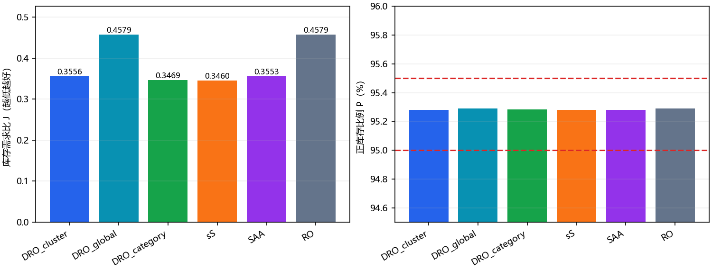
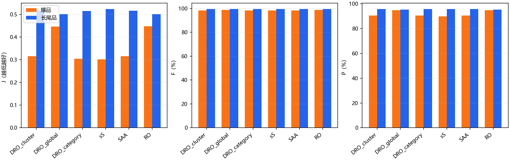
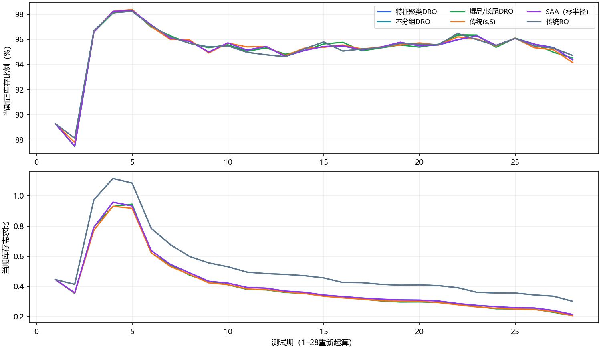

## 新版：正库存比例_最终实验结果报告

定稿日期：2026年10月16日。对象：6000种商品、训练文件60期、测试文件28期。本文锁定正式交付的六方法结果；本次重新回放核验，不重新选择参数。

## 1. 结论先行

在本版本服务约束下，六种正式方法全部达标。测试集库存需求比最低的是传统(s,S)：J=0.345958，需求满足率F=98.5537%，正库存比例P=95.2810%。这里的“最低”仅指已冻结的六种方案在本测试集上的数值比较，不表示求得所有可能策略的全局最优。

新版按所有商品的正库存商品天比例约束95%–95.5%，不是按销量/需求约束。最优的(s,S)为95.2810%，满足“达到95%且不要过高”的要求；分类DRO为95.2821%，J比(s,S)高约0.274%。

焦点比较ΔJ=分类DRO-(s,S)=+0.000949，商品分层配对重抽样95%区间为[-0.003309, +0.004777]。该区间跨0，因此只能报告(s,S)的点估计更低，不能认定其稳定优于分类DRO。

## 2. 数据、业务时序与评价口径

|项目|本次冻结设置|
|---|---|
|训练文件|replenishment_train.xlsx，60期×6000商品=360000条需求观测；每条记录有20个给定特征。|
|测试文件|replenishment_test.xlsx，28期×6000商品=168000个商品天；Period_1作为新业务段起点。|
|商品组成|爆品480种，长尾品5520种；分别占商品数8%和92%。|
|需求权重|爆品占测试需求79.9954%，长尾占20.0046%。标签采用数据给定分类。|
|库存时序|沿用输入期初库存，期初在途为0；本期需求结束后订货，下期需求之前到货。|
|滚动规则|每次预测未来4期、生成4期计划，只执行最近一期订货；提前期1期，无另加盘点周期。|
|缺货|允许缺货，缺口即丢失销售，不结转为欠单；库存不得为负。|

记d_it为商品i第t期需求，A_it为需求前可用库存，I_it为需求后的期末库存，q_it为第t期需求结束后订货量，初始I_i0由文件给出，q_i0=0。每日决策一次是离散模型时间步，不额外叠加盘点等待期。

A_it = I_i,t-1 + q_i,t-1；x_it = min(A_it,d_it)；I_it = max(A_it-d_it,0)；l_it = d_it-x_it。q_it为非负整数，只依赖训练信息和截至t期已经发生的测试需求。

J = Σ_i,t I_it / Σ_i,t d_it（累计期末库存/累计需求，越低越好）；F = Σ_i,t x_it / Σ_i,t d_it（需求满足率）；P = Σ_i,t 1{I_it>0}/(6000×28)（正库存比例）。恰好售罄、期末I=0的商品天不计入P，即使没有丢失销量。无缺货比例C=Σ1{l_it=0}/168000另列，不能与P混用。

本项目曾口头把J称为“周转率”，本文统一写“库存需求比”。常见销售量/平均库存定义的库存周转率通常越高越好，与这里越低越好的J不是同一指标。报告中的平均期末库存为ΣI/168000。

## 3. 数学目标与六种决策方法

政策选择形式：在声明的候选策略集合Π内，min_π J(π)，其中π满足上述库存平衡与非预知条件，并满足0.95≤P(π)≤0.955。需求总量对同一段评估固定，因此比较J等价于比较累计期末库存。候选筛选在训练文件内部进行，测试只报告冻结方案的表现。

实际求解不是一次求解6000商品×28期的联合随机整数规划，而是以预测和鲁棒风险水位构造可执行策略，再在训练回放中选择参数。没有输入仓容、采购预算或订货固定成本，不添加这些约束；四期后续计划按预测需求推进虚拟库存，下一日重新计算。

设m_i,t,h为未来第h期预测，r=d/m为非负相对预测误差。经验样本分布记为P_emp_g，g为商品所属组。DRO集合P_g={Q:W∞(Q,P_emp_g)≤ε，Q支持于非负数}。其含义是每个历史相对误差样本可在半径ε内移动，而不假设只有一个确定需求分布。ε无需求单位。

新版基础水位z_g为W∞集合下的鲁棒β分位数：z_g=经验β分位数(R_g)+ε，对应sup_Q Q(R>z_g)≤1-β的基础机会约束。部署水位还取全60期和四个训练拟合切片水位的逐商品最大值。随后反馈乘数λ可以小于1，所以最终执行策略不继承基础β的逐商品机会保证；实际P靠训练校准并在测试如实验证。

|方法|分组与风险处理|
|---|---|
|特征聚类DRO|使用训练需求形态与给定特征分成6组，每组有独立误差分布及鲁棒水位。|
|不分组DRO|6000商品共用同一相对误差池及鲁棒水位。|
|爆品/长尾DRO|使用文件中爆品/长尾标签分2组，每组独立鲁棒水位。|
|SAA|特征组经验分布，鲁棒半径ε=0，是同构的非鲁棒参照。|
|传统(s,S)|库存低于s才订至S；两水位由商品自身与特征组误差分位数加权估计。|
|传统RO|相对需求不确定集合U=[max(0,μ-Γσ),μ+Γσ]，只优化最坏需求，不优化分布。新版基础z=μ+Γσ，再经包络和共同反馈。|

旧版执行：非(s,S)方法S_i,t,h=m_i,t,h z_i，q=ceil(max(S-I,0))；(s,S)在I<s时补至S。新版执行：S_i,t,h=floor(λ_t m_i,t,h z_i)+1；(s,S)的触发点也按λ缩放并加1，其余方法补至S。+1用于严格期末正库存计数。四期计划使用逐期预测更新虚拟库存，只实施h=1。两版的水位和反馈实现不同，不能将历史排序变化全部归因于单独更换服务公式。

## 4. 特征聚类依据与60期训练如何使用

聚类的5个需求形态变量来自拟合段：log(1+均值)、log(1+变异系数)、零需求比例、log(1+95%分位数/均值)、log(1+末8期均值/前8期均值)。这5列标准化。20个给定特征先在拟合时间段内取均值、标准化，再取PCA前三主成分，主成分标准化后权重为0.5，与需求形态拼接。K-means固定6组、随机种子20260929、8次初始化、最多60次迭代，保留组内平方和最小解。

上述分组依据是需求规模、波动、间歇性、尾部和变化趋势，以及给定特征所反映的相似性；不是把测试效果最好的商品事后分在一起，也不是凭商品名称分组。因20个特征的业务含义未另给出，本文只解释数值处理，不虚构字段含义。爆品/长尾标签与6组特征聚类是两套分类方案。

两版最终模型均重新拟合训练文件第1–60期，全部360000条需求用于最终需求拟合和训练特征汇总。验证时必须留出观测来评价候选，不能把同一批已用于拟合的60期拟合优度当作独立验证成绩。先在训练内部选参数，再全60期重拟合，是完整使用训练数据；不是把前28期弃用。

共同冻结预测参数blend=1、window=3、prior=0：商品线性趋势加最近3个已观测周期的误差校正，预测截断下限为1。每期观测结束后更新，只用过去和当前需求预测未来4期。相对误差库采用训练内部扩展窗口，前18期为热身，此后每6期扩展一次，形成第19–60期共42期的误差；前18期用于拟合热身，并没有从最终模型丢弃。误差生成在相应外层拟合的分组内进行，并非每次重新嵌套聚类。

新版选参：基础设计来自此前训练内候选冻结设置；反馈参数用训练29–60期拟合，1–28期作为28期重启回放。每方法窗口{1,3,7}×先验{0,3}×偏移{-0.01,0,+0.01}共18个候选，六方法共108个。筛选训练P∈[95%,95.5%]后最小J。另有1–24→25–36、1–36→37–48、1–48→49–60的12期向前/重启前缀诊断；这些前缀不是28期服务约束的替代验证。

## 5. 最终冻结参数与测试协议

|方法|基础风险参数|候选ID|训练P|训练J|
|---|---|---|---|---|
|特征聚类DRO|β=0.975, ε=0.005|11|95.2518%|0.448419|
|不分组DRO|β=0.975, ε=0.005|29|95.2512%|0.494242|
|爆品/长尾DRO|β=0.975, ε=0.005|47|95.2536%|0.451021|
|传统(s,S)|p_s=0.975, p_S=0.985|65|95.2607%|0.440173|
|SAA（零半径）|β=0.975, ε=0.0|83|95.2524%|0.448358|
|传统RO|Γ=3.0|101|95.2506%|0.494269|

六方法所选反馈参数相同：response_window=3、response_prior=3、response_bias=+0.01；内部累计目标为95.25%。基础水位取全60期与训练切片(1–24、1–36、1–48、29–60)包络；不再添加此前99%高服务试验的静态储备。

反馈解释：截至t期累计正库存商品天C_t；剩余期数28-t。下一期请求比例b_t=clip((0.9525×168000-C_t)/(6000×max(28-t,1))+0.01,0,1)。按训练误差CDF和最近已实现的一步误差CDF估算下一期正库存比例，寻找最小λ≥0使估计值达到b_t。CDF使用128个中点分位数近似，先验权重为a/(a+n)，a=3。首期需求没有对应的测试前一期预测，不作为一步误差；后续只加入已经发生的误差。

λ搜索从上界1倍增至最多128，随后二分16次。该过程是基于经验CDF的因果反馈，并非对未知测试分布提供硬性概率保证。末期订货仍记录，但28期预算是固定评估长度；迁移到其他长度必须修改预算并重新验证。

最终60期模型、分组和风险水位确定后，才对测试文件滚动运行。测试第1期需求不由测试前订货控制，六方法首期相同：丢失763368件，5357/6000个商品期末库存为正（89.2833%）。所有整体指标均包含这一期，不剔除不利样本。

本项目历经多次依据用户新要求修改，测试文件此前已被反复查看。因此这是修订后同一测试集上的正式结果，不能称为全新未见过的盲测；也没有用本次测试结果重新搜索并替换冻结参数。

## 6. 六方法正式实验结果

|方法|F：销量/需求|P：正库存比例|J：库存/需求|无缺货比例C|
|---|---|---|---|---|
|特征聚类DRO|98.6518%|95.2798%|0.355650|95.5298%|
|不分组DRO|98.9762%|95.2893%|0.457866|95.5488%|
|爆品/长尾DRO|98.6464%|95.2821%|0.346907|95.5429%|
|传统(s,S)|98.5537%|95.2810%|0.345958|95.5226%|
|SAA（零半径）|98.6498%|95.2798%|0.355335|95.5280%|
|传统RO|98.9763%|95.2887%|0.457914|95.5494%|

|方法|正库存商品天|累计期末库存|丢失销量|平均期末库存/商品天|
|---|---|---|---|---|
|特征聚类DRO|160,070/168000|32,173,988|1,219,641|191.5118|
|不分组DRO|160,086/168000|41,421,018|926,168|246.5537|
|爆品/长尾DRO|160,074/168000|31,383,070|1,224,530|186.8040|
|传统(s,S)|160,072/168000|31,297,213|1,308,380|186.2929|
|SAA（零半径）|160,070/168000|32,145,491|1,221,483|191.3422|
|传统RO|160,085/168000|41,425,381|926,095|246.5796|

最低J方案的可手算核验：J=31,297,213/90,465,437=0.345957683；F=89,157,057/90,465,437=98.5537%；P=160,072/168000=95.2810%。六方法面对同一总需求90465437件，J的分母完全一致。

|方法|第28期期末库存|第28期订货/期末在途|
|---|---|---|
|特征聚类DRO|1,142,675|337|
|不分组DRO|1,609,093|316|
|爆品/长尾DRO|1,109,513|328|
|传统(s,S)|1,106,358|350|
|SAA（零半径）|1,143,079|337|
|传统RO|1,610,906|316|

第28期所下订单在第29期到货，故不增加前28期库存指标。报告仍单列期末在途，避免把末期订货当作已消耗或已到库。旧版无反馈而持续订货、与新版固定预算反馈末期订货很小，是两个已部署策略的差别，不能仅凭28期J判断更长周期的成本优劣。

## 7. 爆品、长尾品与全部商品

|方法|类别|F|P|J|
|---|---|---|---|---|
|特征聚类DRO|爆品|98.4261%|90.5357%|0.315448|
|特征聚类DRO|长尾品|99.5545%|95.6923%|0.516410|
|不分组DRO|爆品|98.8420%|94.8065%|0.446932|
|不分组DRO|长尾品|99.5128%|95.3313%|0.501588|
|爆品/长尾DRO|爆品|98.4179%|90.5357%|0.304813|
|爆品/长尾DRO|长尾品|99.5601%|95.6949%|0.515235|
|传统(s,S)|爆品|98.3031%|89.7396%|0.301508|
|传统(s,S)|长尾品|99.5560%|95.7628%|0.523705|
|SAA（零半径）|爆品|98.4235%|90.5134%|0.315038|
|SAA（零半径）|长尾品|99.5547%|95.6942%|0.516472|
|传统RO|爆品|98.8421%|94.8065%|0.446981|
|传统RO|长尾品|99.5130%|95.3306%|0.501634|

整体F按需求量加权，整体P按商品天等权：480种爆品贡献约80%的需求，却仅占8%的P权重。因此整体P达到95%并不意味着每个类别或每种商品都达到95%。例如(s,S)的爆品P低于95%，长尾P高于95%，汇总仍达到95.2810%；本版没有设置逐类别95%的额外约束。

## 8. 滚动表现与四期预测质量

下图展示六种方案的逐期变化，随后分别列出四个预测步长的误差；按完整28期汇总评价，不用某一天的好坏替代整体表现。

|预测步长h|可核对单元数|WAPE|RMSE（件）|
|---|---|---|---|
|1|162000|14.1168%|277.9673|
|2|156000|17.5667%|362.2942|
|3|150000|20.3044%|433.0435|
|4|144000|22.5939%|496.1277|

预测误差仅对测试段内能观察到目标期的预测计算，h=1至4分别有27、26、25、24个预测起点×6000商品。最后一期预测未来4期仍可形成计划，但超出测试段的需求未知，不计入误差；测试首期需求也没有对应本段之前的一步预测。WAPE=Σ|预测-需求|/Σ需求，RMSE=√均方误差。

六方法使用同一套四期需求预测，差异主要来自风险分组、水位和决策。核验全部新旧正式轨迹，最大预测差异仅3.64e-12，来自旧版RO浮点舍入；焦点分类DRO和(s,S)新旧逐值相同。预测步长越长误差越大，说明保留四期计划同时只执行第一步具有实际意义，但并不构成全局最优证明。

## 9. 证据核验、比较边界与复现

本次重新读取12份正式压缩轨迹（新旧各6份），共2016000条商品天记录。逐条核验需求、到货、销量、期末库存、订货和4期计划，并用冻结政策回放逐值比对；摘要表和分组表由轨迹重新计算。证据位于evidence/published_audit.json、published_summary.csv和published_segments.csv，记录轨迹及参数SHA256。

配对区间来自已完成机制实验中的正式历史对比：按爆品480、长尾5520分层，抽样单位为商品完整28期路径，共1000次，随机种子20261016。该区间以训练模型和策略固定为条件，不包含重新训练或时间分布变化的不确定性。保留其来源文件哈希；本报告没有把诊断候选最优结果替换成正式结果。

两版服务约束不同，且旧版使用鲁棒期望缺货水位，新版使用基础分位数、包络和共同反馈。因此旧版J较低并不能直接证明策略更好；它只保证另一种服务要求。原因探索及受控消融另见experiments/constraint_mechanism/reports/机制探索报告.pdf与完整实验报告.pdf，定稿结果与解释实验分开保存。

|用途|项目根目录中的位置或命令|
|---|---|
|本版正式Excel|experiments/service95_revision/outputs_v4/replenishment_comparison.xlsx|
|本版逐期完整明细|experiments/service95_revision/outputs_v4/detail_<method>.csv.gz|
|本版冻结参数|experiments/service95_revision/outputs_v4/frozen_parameters.json|
|重新核验两版正式政策|python experiments/final_results_reports/audit_official.py|
|重建两份报告文字及图|python experiments/final_results_reports/build_reports.py|
|PDF渲染|python experiments/constraint_mechanism/render_reports.py --reports experiments/final_results_reports/reports|
|本版模型实现|experiments/ro_extension/service_band_revision.py；验证器verify_service95.py|

本地文件包根目录为C:/26OR资料/大作业/李佳蔚；报告独立放在“新旧两版定稿实验结果报告”，完整代码、数据和正式Excel在“项目”目录。复现需Python及项目requirements_v3.txt依赖；生成图片还需matplotlib，渲染PDF需reportlab、pypdf及中文字体。无需Git元数据即可生成报告。报告重建读取冻结正式结果，不重新调参；重新训练请另建输出目录以保留定稿证据。

来源：训练和测试原始文件SHA256见evidence/source_manifest.json；输入全面流式核验记录见experiments/constraint_mechanism/outputs/input_audit.json。方法参考RSOME官方多阶段DRO库存示例：https://xiongpengnus.github.io/rsome/example_dro_inv 。本项目使用专用水位计算和滚动政策回放，没有将RSOME示例求解器结果冒充为本项目全局最优解。
