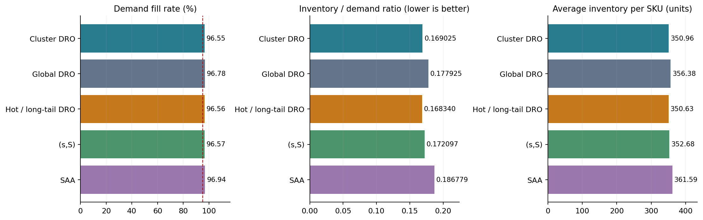
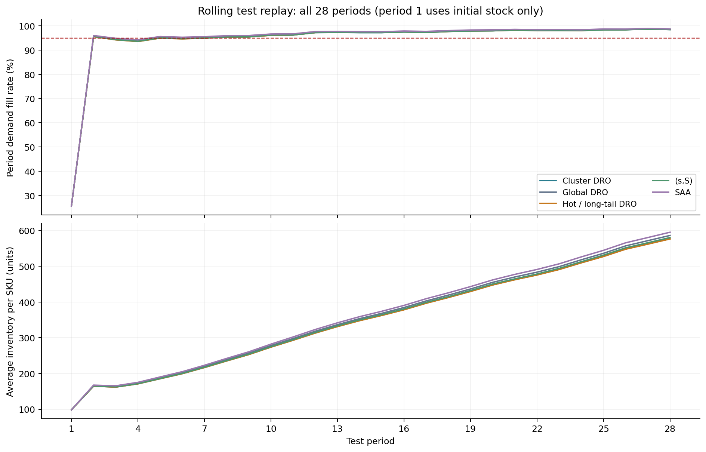
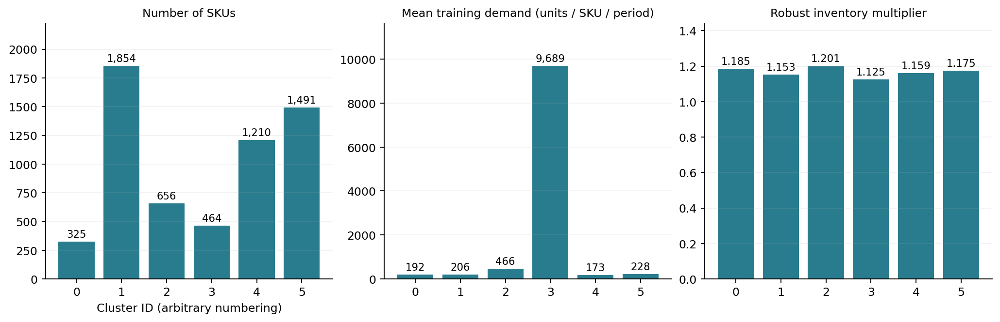

# 可视化展示

下载仓库后双击本目录的[index.html](index.html)，即可离线查看全部图表，并切换策略查阅28期数值。该HTML内嵌图表和数据，不需要网络或服务器。GitHub文件页显示HTML源码，下面的PNG可以直接在线查看。

## 五种策略的最终比较



## 28期滚动表现



测试第1期只能使用初始库存，所有策略共享该期缺货。总体满足率95%的目标不等于每个周期都达到95%。

## 六类特征聚类的风险画像



聚类编号只是标识，不能解释为库存风险从低到高的排名。各组特征定义见[聚类说明](../../../docs/rolling_dro_v3/CLUSTERING.md)。

从保存的CSV重建展示：

```bash
python experiments/rolling_dro_v3/build_visualizations.py
```

PNG用于直接查看，SVG适合缩放或插入报告，HTML用于离线交互。静态图表用英文标签以兼容没有中文字体的运行环境，HTML和结果解读使用中文。
