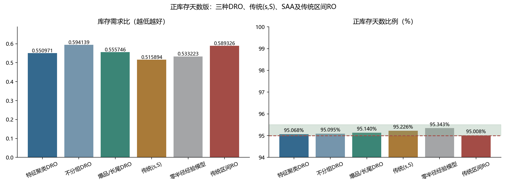

# 正库存天数版：新增传统RO的完整交付

服务要求为期末库存>0的商品－天数÷全部商品－天数，范围95%–95.5%。优化累计期末库存÷总需求（越低越好）。新增RO后，共比较三种DRO、传统(s,S)、SAA、传统区间RO。

- [六方法完整报告与RO数学模型](REPORT.md)
- [六方法Excel](outputs_v4/replenishment_comparison.xlsx)
- [离线交互页面](visualization/index.html)
- [库存与服务对比图](visualization/six_method_comparison.png)
- [逐期结果图](visualization/period_comparison.png)
- [六方法汇总](outputs_v4/summary.csv)
- [全量逐商品逐期并列决策](outputs_v4/decision_comparison_full.csv.gz)
- [新旧两版比较](../../version_comparison/COMPARISON.md)
- [可运行代码及复现命令](../../ro_extension/README.md)

原版五方法交付保存在上一级outputs_v4；本目录复用其原始轨迹并加入RO，原文件保持字节一致。
